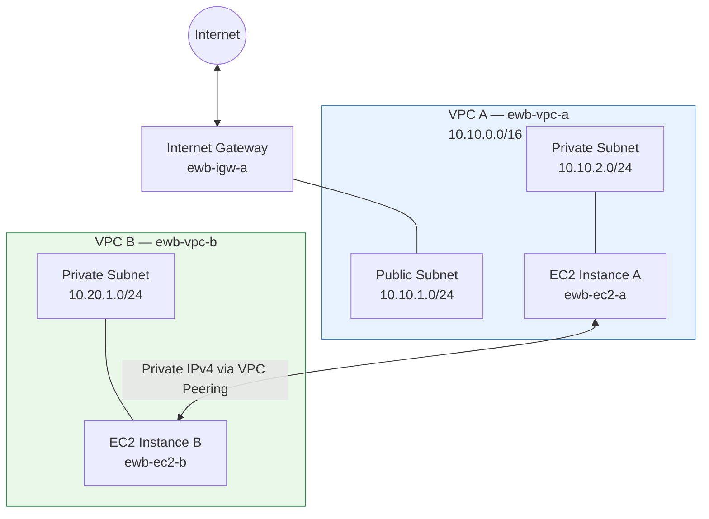

# ☁️ AWS VPC Peering Project: Private Cross-VPC Connectivity

A hands-on AWS networking project demonstrating how to connect two Amazon Virtual Private Clouds (VPCs) using **VPC Peering** for private IPv4 communication without routing traffic through the public internet.

## 📌 Project Overview

| Detail | Description |
|---|---|
| Project | AWS VPC Peering |
| Programme | EWB Courses – AWS Architect Associate |
| Project Number | Project 01 |
| Region | Asia Pacific (Sydney) |
| AWS Region Code | `ap-southeast-2` |
| Completion Date | 18 October 2026 |
| VPCs | 2 |
| Subnets | 3 |
| EC2 Instances | 2 × `t3.micro` |
| Peering Connection | 1 active connection |

## 🎯 Objectives

- Establish private communication between two separate AWS VPCs.
- Design non-overlapping VPC and subnet CIDR ranges.
- Configure public and private subnets with appropriate route tables.
- Create and activate a VPC peering connection.
- Configure security groups following the principle of least privilege.
- Verify private connectivity using ICMP ping and SSH.
- Understand routing, network isolation, and AWS security controls.

## 🏗️ Architecture

The project uses two VPCs connected through a VPC peering connection.

- **VPC A (`ewb-vpc-a`)** contains one public subnet and one private subnet.
- **VPC B (`ewb-vpc-b`)** contains one private subnet and has no internet gateway.
- Both VPCs use private IPv4 CIDR ranges.
- Routes in both VPCs direct cross-VPC traffic through the peering connection.
- An internet gateway is attached only to VPC A.

### Architecture Diagram



**Important:** VPC peering provides private connectivity between the two VPCs. It does not automatically provide internet access to VPC B through VPC A.

## 📐 IP Address Plan

| Resource | VPC | IPv4 CIDR |
|---|---|---|
| `ewb-vpc-a` | VPC A | `10.10.0.0/16` |
| `ewb-a-public` | VPC A | `10.10.1.0/24` |
| `ewb-a-private` | VPC A | `10.10.2.0/24` |
| `ewb-vpc-b` | VPC B | `10.20.0.0/16` |
| `ewb-b-private` | VPC B | `10.20.1.0/24` |

The VPC CIDR ranges do not overlap, allowing the VPCs to communicate through peering.

## 🧰 AWS Services Used

- **Amazon VPC:** Creates isolated virtual networks.
- **VPC Peering:** Connects the two VPCs privately.
- **Amazon EC2:** Hosts the test instances.
- **Subnets:** Separate public and private resources.
- **Internet Gateway:** Provides internet connectivity for the public subnet in VPC A.
- **Route Tables:** Control traffic destinations.
- **Security Groups:** Apply stateful, instance-level traffic filtering.
- **Network ACLs:** Apply stateless, subnet-level traffic filtering.
- **AWS CLI:** Supports infrastructure configuration, verification, and cleanup.

## ⚙️ Implementation Steps

### Step 1: Create Two VPCs

Create the following VPCs in `ap-southeast-2`:

- VPC A: `10.10.0.0/16`
- VPC B: `10.20.0.0/16`

Assign the corresponding Name tags:

- `ewb-vpc-a`
- `ewb-vpc-b`

### Step 2: Create the Subnets

Create three subnets:

1. `ewb-a-public` — `10.10.1.0/24`
2. `ewb-a-private` — `10.10.2.0/24`
3. `ewb-b-private` — `10.20.1.0/24`

Associate each subnet with the appropriate route table.

### Step 3: Configure the Internet Gateway

Create an internet gateway named `ewb-igw-a` and attach it to VPC A.

Configure the public subnet's route table with:

```text
Destination       Target
10.10.0.0/16      local
0.0.0.0/0         Internet Gateway
10.20.0.0/16      VPC Peering Connection
```

The default route enables internet-bound traffic from the public subnet through the internet gateway, subject to the necessary subnet and instance configuration.

### Step 4: Create the VPC Peering Connection

Create a peering connection between VPC A and VPC B.

- Requester: `ewb-vpc-a`
- Accepter: `ewb-vpc-b`
- Name: `ewb-a-b-peer`

Accept the peering request and verify that its status is **Active**.

### Step 5: Configure the Route Tables

Add routes to both VPCs so that traffic can travel in both directions.

| Route table | Destination | Target |
|---|---|---|
| `ewb-rt-a-private` | `10.10.0.0/16` | Local |
| `ewb-rt-a-private` | `10.20.0.0/16` | Peering connection |
| `ewb-rt-b-private` | `10.20.0.0/16` | Local |
| `ewb-rt-b-private` | `10.10.0.0/16` | Peering connection |
| `ewb-rt-a-public` | `10.10.0.0/16` | Local |
| `ewb-rt-a-public` | `0.0.0.0/0` | Internet gateway |
| `ewb-rt-a-public` | `10.20.0.0/16` | Peering connection |

**Key point:** Both sides need the appropriate routes. A route in only one VPC is insufficient for bidirectional communication.

### Step 6: Launch EC2 Instances

Launch two EC2 instances using the `t3.micro` instance type.

| Instance | VPC | Subnet |
|---|---|---|
| `ewb-ec2-a` | VPC A | Private subnet |
| `ewb-ec2-b` | VPC B | Private subnet |

Use the same AWS Region and configure the instances with suitable security groups. The test instances should not require public IPv4 addresses for private VPC-to-VPC communication.

### Step 7: Configure Security Groups

Configure inbound rules for the two application security groups.

| Security group | Protocol | Allowed source |
|---|---|---|
| `ewb-sg-app-a` | ICMP Echo Request | Private IPv4 address of Instance B (`/32`) |
| `ewb-sg-app-a` | SSH, TCP 22 | Private IPv4 address of the authorized administration host (`/32`) |
| `ewb-sg-app-b` | ICMP Echo Request | Private IPv4 address of Instance A (`/32`) |
| `ewb-sg-app-b` | SSH, TCP 22 | Private IPv4 address of the authorized administration host (`/32`) |

Apply the principle of least privilege. Do not open SSH or ICMP to `0.0.0.0/0` unnecessarily.

Also verify that the network ACLs and operating-system firewalls allow the required traffic.

## 🧪 Testing and Verification

### 1. Check the Instance's Private IP

Run on an EC2 instance:

```bash
hostname -I
```

Record the private IPv4 addresses of both instances.

### 2. Test Private Connectivity

From Instance A, ping the private IPv4 address of Instance B:

```bash
ping -c 4 <INSTANCE_B_PRIVATE_IP>
```

From Instance B, test the reverse direction:

```bash
ping -c 4 <INSTANCE_A_PRIVATE_IP>
```

Replace the placeholders with the actual private IPv4 addresses.

**Expected result:** Four replies with `0% packet loss` in each direction when routes, security groups, network ACLs, and host firewalls permit ICMP.

### 3. Test SSH Connectivity

SSH into Instance B using an authorized bastion host or another permitted administration path:

```bash
ssh -i <KEY_FILE.pem> \
  -J ec2-user@<BASTION_HOST> \
  ec2-user@<INSTANCE_B_PRIVATE_IP>
```

Replace the placeholders with the actual key file, bastion address, and destination private IP. This command assumes an appropriate bastion host, SSH key, and security-group rules are configured.

### 4. Verify Private-Only Instances

Using the AWS CLI:

```bash
aws ec2 describe-instances \
  --instance-ids <INSTANCE_A_ID> <INSTANCE_B_ID> \
  --query 'Reservations[].Instances[].[InstanceId,PublicIpAddress,PrivateIpAddress]' \
  --output table \
  --region ap-southeast-2
```

Confirm that the private test instances have no public IPv4 addresses.

### 5. Perform a Controlled Failure Test

1. Remove the ICMP Echo Request inbound rule from `ewb-sg-app-b`.
2. Ping Instance B from Instance A.
3. Verify that the ping requests fail.
4. Restore the security-group rule.
5. Repeat the test and confirm that connectivity resumes.

This experiment demonstrates how security-group rules control communication even when the VPC peering connection and routes are active.

## 📊 Test Results

| Test | Expected result |
|---|---|
| Baseline before peering routes | No replies |
| Forward path after route configuration | 4 replies, 0% packet loss |
| Reverse path after route configuration | 4 replies, 0% packet loss |
| SSH through the authorized bastion path | Shell access to Instance B |
| Public IP verification | No public IPv4 addresses on the private test instances |
| ICMP rule removed | Ping fails |
| ICMP rule restored | Ping resumes |

These are the expected outcomes documented for the project; actual results should be confirmed in the AWS environment.

## 💻 AWS CLI Examples

The following examples illustrate the main infrastructure creation steps. Run them in an AWS CLI environment with suitable permissions and a configured account.

### Set the AWS Region

```bash
export AWS_DEFAULT_REGION=ap-southeast-2
```

### Create VPC A

```bash
VPC_A=$(aws ec2 create-vpc \
  --cidr-block 10.10.0.0/16 \
  --query 'Vpc.VpcId' \
  --output text)

aws ec2 create-tags \
  --resources "$VPC_A" \
  --tags Key=Name,Value=ewb-vpc-a
```

### Create VPC A Subnets

```bash
SUB_A_PUB=$(aws ec2 create-subnet \
  --vpc-id "$VPC_A" \
  --cidr-block 10.10.1.0/24 \
  --availability-zone ap-southeast-2a \
  --query 'Subnet.SubnetId' \
  --output text)

SUB_A_PRIV=$(aws ec2 create-subnet \
  --vpc-id "$VPC_A" \
  --cidr-block 10.10.2.0/24 \
  --availability-zone ap-southeast-2a \
  --query 'Subnet.SubnetId' \
  --output text)
```

### Create and Attach the Internet Gateway

```bash
IGW=$(aws ec2 create-internet-gateway \
  --query 'InternetGateway.InternetGatewayId' \
  --output text)

aws ec2 attach-internet-gateway \
  --internet-gateway-id "$IGW" \
  --vpc-id "$VPC_A"
```

### Create VPC B and Its Private Subnet

```bash
VPC_B=$(aws ec2 create-vpc \
  --cidr-block 10.20.0.0/16 \
  --query 'Vpc.VpcId' \
  --output text)

aws ec2 create-tags \
  --resources "$VPC_B" \
  --tags Key=Name,Value=ewb-vpc-b

SUB_B=$(aws ec2 create-subnet \
  --vpc-id "$VPC_B" \
  --cidr-block 10.20.1.0/24 \
  --availability-zone ap-southeast-2a \
  --query 'Subnet.SubnetId' \
  --output text)
```

### Create the Peering Connection

```bash
PCX=$(aws ec2 create-vpc-peering-connection \
  --vpc-id "$VPC_A" \
  --peer-vpc-id "$VPC_B" \
  --query 'VpcPeeringConnection.VpcPeeringConnectionId' \
  --output text)

aws ec2 accept-vpc-peering-connection \
  --vpc-peering-connection-id "$PCX"
```

### Add the Peering Routes

After creating and associating the appropriate route tables, add the cross-VPC routes:

```bash
aws ec2 create-route \
  --route-table-id "$RT_A_PRIV" \
  --destination-cidr-block 10.20.0.0/16 \
  --vpc-peering-connection-id "$PCX"

aws ec2 create-route \
  --route-table-id "$RT_A_PUB" \
  --destination-cidr-block 10.20.0.0/16 \
  --vpc-peering-connection-id "$PCX"

aws ec2 create-route \
  --route-table-id "$RT_B" \
  --destination-cidr-block 10.10.0.0/16 \
  --vpc-peering-connection-id "$PCX"
```

**Note:** The route-table variables above must be assigned to the actual route-table IDs before these commands are executed. The examples are partial setup commands, not a complete one-shot deployment script. Security groups, EC2 instances, and the remaining configuration must also be created or configured.

## 🧹 Resource Cleanup

To avoid ongoing AWS charges, terminate the EC2 instances and remove the project resources when testing is complete.

Recommended cleanup order:

1. Terminate the EC2 instances and wait for termination to complete.
2. Delete the cross-VPC routes.
3. Delete the VPC peering connection.
4. Delete the security groups after removing dependent resources.
5. Delete the subnets.
6. Delete custom route tables after disassociating them from subnets.
7. Detach and delete the internet gateway.
8. Delete both VPCs.

Example command for terminating the project instances:

```bash
aws ec2 terminate-instances \
  --instance-ids <INSTANCE_A_ID> <INSTANCE_B_ID> \
  --region ap-southeast-2
```

Use the actual resource IDs or the environment variables from your setup. Check resource dependencies before deletion, and do not delete resources that belong to other workloads.

## 🧠 Key Learnings

- VPC peering enables private IPv4 communication between two VPCs.
- VPC CIDR ranges must not overlap.
- Correct routes are required in both directions.
- Security groups are stateful; network ACLs are stateless.
- The most specific matching route takes precedence.
- VPC peering is non-transitive.
- VPC peering does not share an internet gateway or automatically grant internet access to the peer VPC.
- Controlled failure testing helps isolate networking and security issues.
- Resources should be cleaned up in dependency order to prevent unnecessary charges.

## 🚀 Conclusion

This project demonstrates how to establish secure private communication between two AWS VPCs using VPC Peering, route tables, EC2 instances, and security groups.

The implementation provides practical experience with AWS networking, IP addressing, traffic routing, access control, connectivity testing, and resource management.

## 📚 References

- [Amazon VPC Documentation](https://docs.aws.amazon.com/vpc/latest/userguide/what-is-amazon-vpc.html)
- [VPC Peering Documentation](https://docs.aws.amazon.com/vpc/latest/peering/what-is-vpc-peering.html)
- [Amazon EC2 Documentation](https://docs.aws.amazon.com/ec2/)
- [AWS CLI Documentation](https://docs.aws.amazon.com/cli/)

---


**Project:** AWS VPC Peering – Private Cross-VPC Connectivity

**Region:** `ap-southeast-2`
